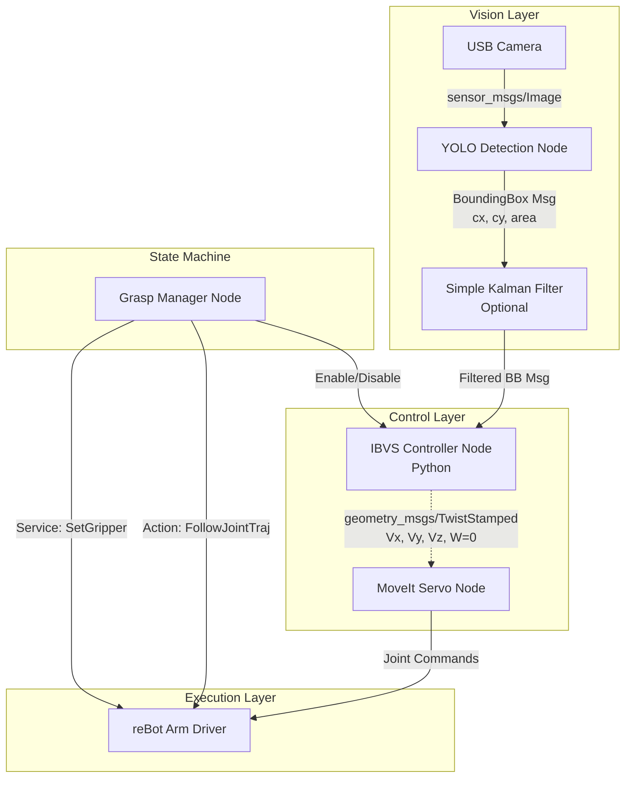

## Goal Description
The objective is to build a robust, simplified Image-Based Visual Servoing (IBVS) pipeline to grasp a falcon tube from a rack using a reBot B601DM (6+1 DOF) arm. 

Since the tube is approached from the side, the **gripper orientation can be fixed/hardcoded**. This drastically simplifies the control problem: we only need to control translation (X, Y, Z velocities) while MoveIt Servo maintains the fixed orientation.

The pipeline uses an eye-in-hand 2D USB camera and a YOLO object detection model.

## User Review Required
> [!IMPORTANT]
> **MoveIt Servo Dependency:** This plan heavily relies on **MoveIt Servo**. It is the absolute easiest and safest way to stream Cartesian velocities to the arm without manually writing complex inverse kinematics and collision avoidance code in C++. Are you comfortable installing and configuring MoveIt Servo for the workspace?
> 
> **Camera Alignment & Target Pixel:** Because the camera is mounted at a slight angle (not perfectly parallel to the gripper), centering the tube in the camera image will *not* center the tube in the gripper fingers. We will solve this easily by **offsetting the target pixel**. Instead of telling the IBVS to drive the tube to the exact center of the image `(640, 360)`, you will manually place a tube in the gripper, check where it appears in the camera image (e.g., `(640, 480)`), and set *that* specific pixel as your target.

## Proposed System Architecture

To achieve the "easiest way", the system is broken down into four distinct, loosely coupled ROS 2 modules (nodes). This allows you to test each piece individually.

---

## Module Breakdown & Implementation Strategy

### 1. Grasp Manager Node (The State Machine)
**Role:** Coordinates the sequence of events. It is a standard Python node.
**Workflow:**
1. **Gross Approach:** Sends a predefined "Scanning Pose" to MoveIt 2. The arm moves to view the rack.
2. **Enable Vision:** Triggers the IBVS Controller Node to start publishing velocities.
3. **Wait for Convergence:** Monitors the IBVS error. When the error is near zero for `N` seconds, it disables the IBVS node.
4. **Grasp:** Calls the `/rebotarm/set_gripper` service to close the DM gripper to `0.0`.
5. **Retreat:** Sends a MoveIt 2 command to move straight up along the Z-axis to extract the tube.

### 2. YOLO Detection Node
**Role:** Extracts the tube location from the image.
**Workflow:**
* Written as a custom ROS 2 Python node using the `ultralytics` library directly.
* Subscribes to `/camera/image_raw` (and ideally uses `camera_info` to undistort).
* Runs the YOLO inference using `model.predict()`.
* Publishes a custom message (or `vision_msgs/BoundingBox2D`) containing:
  * `center_x`, `center_y` (pixel coordinates)
  * `area` (width * height in pixels). *We use area as a proxy for depth/distance.*

### 3. IBVS Controller Node (The Core Logic)
**Role:** The "Brain" of the visual servoing. It calculates how fast the robot should move to center the tube in the camera.
**Workflow:**
* Written in Python for simplicity.
* Takes target values: `target_x` (the calibrated pixel X where the gripper closes), `target_y` (the calibrated pixel Y where the gripper closes), `target_area` (how big the tube should be when the gripper is at grasping distance).
* **Control Law (Simple Proportional Controller):**
  * $V_x = K_x \times (target_x - current_x)$
  * $V_y = K_y \times (target_y - current_y)$
  * $V_z = K_z \times (target_area - current_area)$
  * Angular velocities ($\omega_x, \omega_y, \omega_z$) are strictly set to `0.0` because we want to maintain the hardcoded side-approach orientation.
* Publishes the resulting `geometry_msgs/TwistStamped` to the MoveIt Servo input topic.

### 4. MoveIt Servo Node
**Role:** Translates Cartesian velocities into safe joint commands.
**Workflow:**
* This is a standard ROS 2 package provided by MoveIt. 
* It receives your `TwistStamped` commands.
* It checks for collisions with the rack or robot body.
* It calculates the Inverse Jacobian to find joint velocities.
* It streams the joint velocities down to the `rebotarm_ros2` hardware interfaces (`cmd/pos_vel`).

---

## Verification Plan

Because you do not have hardware, we will verify this pipeline using MoveIt's simulated hardware environment in RViz (`demo.launch.py`).

### Automated/Simulation Tests
1. **RViz Mock Hardware:** Launch the existing workspace simulation (`ros2 launch rebotarm_moveit_config demo.launch.py`). This starts RViz and the `ros2_control` mock hardware. 
2. **MoveIt Servo Configuration:** We will run MoveIt Servo connected to this simulated hardware. Publish dummy `TwistStamped` messages using command line (`ros2 topic pub`) and verify in RViz that the simulated arm moves in pure translation while holding its orientation.
2. **Vision Node Test:** Feed a pre-recorded video of a falcon tube into the YOLO node. Verify that the BoundingBox topic is published consistently at >15 Hz.
3. **Controller Test:** Feed mock bounding box coordinates into the IBVS Controller Node and verify that the output `TwistStamped` velocities ramp down to exactly zero as the mock coordinates approach the target center.

### Manual Verification
* Ensure the Hand-Eye calibration transform (`static_transform_publisher`) aligns the Camera's Z-axis with the Gripper's forward axis, otherwise the $V_z$ command will not move the arm toward the tube.
